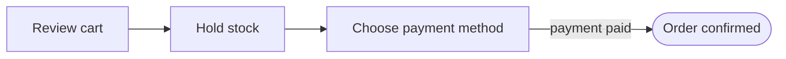

# flowscribe-flow

A flow document is the single source for the flow's diagram, its screenshots and its video storyboard,
so its frontmatter must be exact.

## Write the flow
1. Trace the journey in the code: entry route or trigger, each screen or system step, the calls each
   step makes, the states it can end in, and the branches.
2. Write `.flowscribe/flows/<id>.md` from `.flowscribe/templates/flow.md`.
   - `kind`: `screen` (a page the actor sees), `action` (actor does something without a new page),
     `system` (server work), `decision` (a branch point), `external` (a third party), `subflow`.
   - `screen.route` is a path such as `/orders/:order` — never a full URL or host.
   - `calls` targets are `METHOD /path`, class or event names, or service names (`payment-gateway`).
   - At most 20 steps. Split longer journeys and link them with a `subflow` step.
   - `caption` (≤ 60 chars) is what a video shows on that step; write it for a viewer, not a developer.
3. Add the flow id to the `modules` it touches, and regenerate the index (see `flowscribe-init`).

## Diagram (when asked)
Render Mermaid from the frontmatter only — do not invent steps:

Node ids are step ids with `-` replaced by `_` (Mermaid reads `-` as part of an arrow); labels are
step titles in double quotes. Terminal steps (`end`) use the rounded `([ ])` shape. Put the diagram in the document body under
`## Diagram`, or give it to the user, as they prefer.

## Screenshots (only when asked)
- Allowed hosts: `localhost`, `127.0.0.1`, and `capture.allowed_hosts` in `.flowscribe/config.yaml`.
  Refuse any other host, and stop if the app shows real customer data — ask the user for seed data.
- Use a browser automation tool you already have (Playwright or similar). Do not install one without
  asking the user first.
- Save to `.flowscribe/screens/<flow-id>/<step-id>.png` (git-ignored). Never commit screenshots.
- Never type real credentials. Use test accounts from the project's seed or example config.
